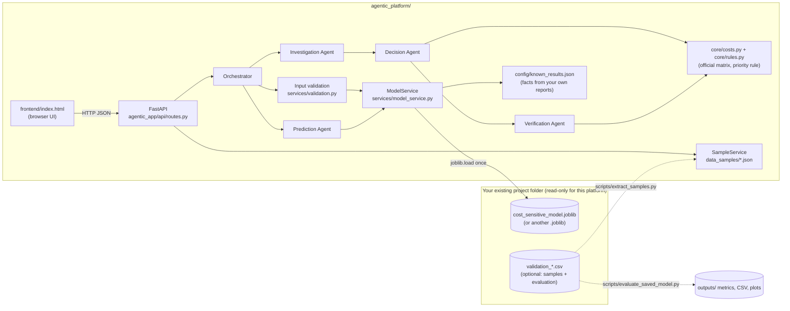
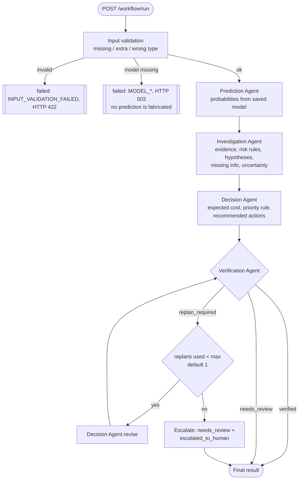
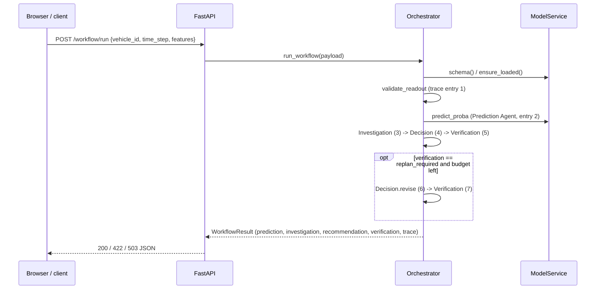

# Architecture, workflow and data flow

## System architecture

## Agent workflow

## Sequence for one run

## Data flow and objects

| Stage | Input | Output object (`agentic_app/schemas/types.py`) |
|---|---|---|
| Input validation | request JSON | `ValidatedReadout` (features ordered like the model's `feature_cols`, null counts, unseen categories) |
| Prediction | `ValidatedReadout` | `PredictionResult` (5 probabilities, P(any failure), P(class 3-4), entropy, risk summary, model notes) |
| Investigation | readout + prediction | `Investigation` (evidence items `observed` / `model_output` / `derived`, risk indicators, hypotheses flagged unverified, missing information, uncertainty) |
| Decision | readout + prediction + investigation | `Recommendation` (cost-minimising class, expected costs, priority + rule id, actions, explanation, evidence refs, uncertainty statement) |
| Verification | all of the above | `VerificationResult` (`verified` / `needs_review` / `replan_required`, 10 named checks, reasons) |
| Orchestrator | all | `WorkflowResult` incl. `trace` (stage, agent, status, UTC start/end, duration, input summary, output) |

Each agent has one responsibility; none calls an LLM. The workflow is deterministic: the same payload and the same model file give identical prediction, investigation, recommendation and verification (only trace timestamps and durations differ; `input_fingerprint` is a hash of the payload).
